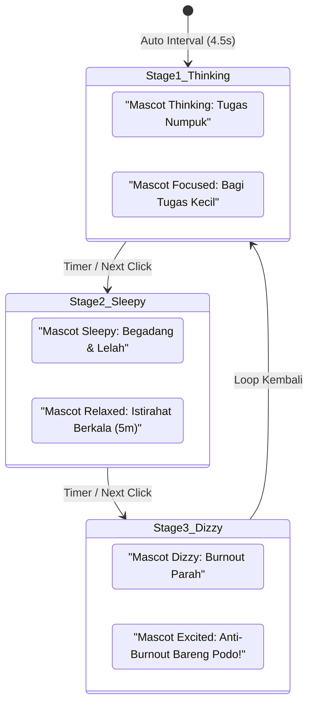

# Rencana & Dokumentasi Teknis: Enhance Landing Page & Living Mascot Timer UI

> **Dokumen Terkait:**  
> - [FRONTEND_HANDOVER_DOCUMENTATION.md](./FRONTEND_HANDOVER_DOCUMENTATION.md)  
> - [MASCOT_SIDEBAR_AND_UI_ENHANCEMENT_PLAN.md](./MASCOT_SIDEBAR_AND_UI_ENHANCEMENT_PLAN.md)  
> - [MASCOT_ANIMATION_PLAN_V2.md](./MASCOT_ANIMATION_PLAN_V2.md)  
> - [README.md](./README.md)  
> **Status:** Diimplementasikan & Lolos Uji Typecheck (Code 0)  
> **Tanggal:** Oktober 2026  

---

## 1. Ringkasan Kebutuhan & Latar Belakang

Sesuai permintaan revisi desain antarmuka, halaman utama (*Landing Page* / Guest View) diperbarui agar memiliki daya tarik visual yang kuat (*high visual impact*), interaktif, dan langsung mendemokan pengalaman belajar bersama maskot **Podo**.

### Poin Kebutuhan Utama:
1. **Headline & Text Highlight:**
   - Judul utama: **"Gini cara belajar ala Podo."** di mana kata **"Podo."** di-highlight dengan warna oranye khas (`#F56A16` / `text-orange-500`).
2. **Maskot Peeking di Belakang Kartu Timer:**
   - Karakter Podo (blob oranye bersih dengan mata kapsul hitam solid) menyembul dari balik bagian atas kartu timer.
   - Memiliki animasi gerak berulang naik-turun yang halus (*loop up & down bobbing animation*).
   - Mengadopsi teknologi interaksi dari `MASCOT_SIDEBAR_AND_UI_ENHANCEMENT_PLAN.md`: kedua mata melirik dan mengikuti pergerakan kursor mouse pengguna (*eye cursor tracking*) secara halus dengan batasan rongga alami dan kedipan natural.
   - **Clickable:** Saat maskot diklik, maskot memberikan respons visual loncat ceria (*playful jump*) dan langsung mengarahkan pengguna (*redirect*) ke halaman pendaftaran (`/signup`).
3. **Kartu Timer Khusus Landing Page (`LandingHeroTimer.vue`):**
   - Kartu sudut melengkung besar (*rounded card*) berlatar *warm cream* (`#fffcf9`) dengan *border* oranye tegas (`border-[3px] border-[#f56a16]`) dan bayangan lembut.
   - Tampilan angka waktu besar `25:00` (*digital countdown*).
   - **Baris Tombol Kontrol (Sesuai Gambar Referensi):**
     - **Reset / Ulangi:** Tombol kotak melengkung warna *soft peach* (`#fbd1b3`) dengan ikon panah putar melingkar berisi jarum jam.
     - **Play / Pause (Centerpiece):** Kotak oranye (`#f56a16`) dengan garis tepi sketsa tinta organik/hand-drawn (`stroke="#151612"`) dan ikon segitiga hitam solid.
     - **Skip / Forward:** Tombol kotak melengkung warna *soft peach* (`#fbd1b3`) dengan ikon lewati ke depan.
   - **Tombol 'Selesai Sesi':**
     - Tombol penuh (*full-width*) warna *soft peach* (`#fbd1b3`) bertuliskan **"Selesai Sesi"** dengan font tebal (`text-[#8c3d10] font-black`), mengarahkan pengguna ke `/signup` agar hasil belajarnya tersimpan.
4. **Aliasing Route `/signup`:**
   - Menambahkan alias resmi `alias: ['/signup']` pada `app/pages/register.vue` sehingga navigasi ke `/signup` atau `/register` berjalan mulus.

---

## 2. Rincian Teknis & Arsitektur Implementasi

### A. Integrasi Langsung ke `PomodoroTimer.vue` (Prop `peeking-mascot`)
Lokasi: `frontend/app/components/PomodoroTimer.vue`

Alih-alih membuat tiruan timer terpisah, fungsionalitas maskot peeking diintegrasikan langsung ke dalam `PomodoroTimer.vue` melalui prop opsional `:peeking-mascot="true"`:
- **Keunggulan:**
  - Tetap mempertahankan 100% fungsionalitas timer asli (mode switch Fokus/Istirahat, audio alarm, web audio synth chime, Floating/PiP timer, dan dialog interaktif Podo).
  - Alur **"Selesaikan Sesi"** tetap memicu pop-up perayaan (*Session Completed Celebration Modal*) secara natural untuk pengunjung tanpa dipaksa redirect/login.
  - Pada halaman dashboard (pengguna sudah login), `peekingMascot` bernilai `false` (default) sehingga tata letak dashboard tetap bersih.

```
PomodoroTimer (Container relative)
 ├── cardHostRef (flex justify-center relative, pt-16 sm:pt-20)
 │    ├── Mascot Peeking Group (v-if="peekingMascot", z-0, -top-[68px])
 │    │    ├── Tooltip Hover ("Klik aku buat daftar!")
 │    │    └── SVG Maskot Podo (Eye Tracking + Blink + Bobbing Loop)
 │    └── cardRef (relative, z-10, bg-white rounded-3xl border-2 border-orange-400)
 │         ├── PiP Button
 │         ├── Mode Switcher (Work vs Break)
 │         ├── Timer Countdown 25:00
 │         ├── Control Buttons Row (Reset, Play/Pause, Skip)
 │         ├── Selesaikan Sesi Button -> completeSession()
 │         └── AI Companion Speech Bubble
 └── Session Completed Celebration Modal (Pop-up Perayaan)
```

### B. Mekanisme Animasi Maskot

#### 1. Animasi Loop Up & Down (Bobbing)
Menggunakan keyframe CSS murni yang ringan tanpa beban JavaScript:
```css
.mascot-peeking-container {
  animation: mascot-peek-loop 3.8s ease-in-out infinite;
  transform-origin: bottom center;
}

@keyframes mascot-peek-loop {
  0%, 100% {
    transform: translateY(0);
  }
  50% {
    transform: translateY(-16px);
  }
}
```

#### 2. Pelacakan Kursor Mata (Mouse Cursor Tracking)
Mengukur posisi relatif kursor terhadap pusat mata maskot di viewport:
```ts
function handleMouseMove(e: MouseEvent) {
  if (!mascotRef.value) return

  const rect = mascotRef.value.getBoundingClientRect()
  const eyeCenterX = rect.left + rect.width / 2
  const eyeCenterY = rect.top + rect.height * 0.42

  const dx = e.clientX - eyeCenterX
  const dy = e.clientY - eyeCenterY
  const dist = Math.hypot(dx, dy)

  const maxShiftX = 14
  const maxShiftY = 10

  if (dist > 0) {
    const factor = Math.min(dist / 260, 1)
    eyeShiftX.value = (dx / dist) * maxShiftX * factor
    eyeShiftY.value = (dy / dist) * maxShiftY * factor
  }
}
```

#### 3. Animasi Kedip Natural (Natural Blink)
```css
@keyframes podo-eye-blink {
  0%, 45%, 49%, 100% {
    transform: scaleY(1);
  }
  47% {
    transform: scaleY(0.08);
  }
}
```

#### 4. Interaksi Klik & Redirect ke `/signup`
Saat maskot diklik:
1. State `isJumping.value = true` memicu keyframe loncatan ceria (`mascot-jump-out`).
2. Setelah 350ms (ketika puncak loncatan tercapai), Nuxt mengeksekusi `navigateTo('/signup')`.

---

## 3. Implementasi Halaman `app/pages/index.vue`

Bagian `v-else` (Guest View) diperbarui untuk menampilkan judul baru dan merender komponen hero timer:

```html
<!-- Title Tagline Sesuai Gambar Referensi -->
<div class="text-center max-w-2xl mx-auto mb-1">
  <h1 class="text-3xl sm:text-5xl md:text-6xl font-black text-stone-900 tracking-tight leading-tight">
    Gini cara belajar ala <span class="text-orange-500">Podo.</span>
  </h1>
  <p class="text-sm sm:text-base font-semibold text-stone-600 mt-3 sm:mt-4">
    Fokus sebentar, istirahat sejenak. Podo siap nemenin kamu belajar lebih teratur dan bebas burnout!
  </p>
</div>

<!-- Centered Interactive Hero Mascot Timer (Peeking Mascot + Click to Signup) -->
<LandingHeroTimer />
```

---

## 4. Konfigurasi Route Alias di `app/pages/register.vue`

Ditambahkan `definePageMeta`:
```ts
definePageMeta({
  alias: ['/signup'],
})
```
Hal ini memastikan URL `/signup` dapat diakses langsung oleh browser atau dipanggil melalui `navigateTo('/signup')`.

---

## 5. Ringkasan File yang Diubah & Dibuat

| Berkas | Jenis | Deskripsi |
|---|---|---|
| `frontend/app/components/LandingHeroTimer.vue` | **Baru** | Komponen timer interaktif dengan maskot peeking up-down, eye tracking, dan tombol bergaya referensi. |
| `frontend/app/pages/index.vue` | **Modifikasi** | Memperbarui tampilan Guest dengan headline "Gini cara belajar ala Podo." dan mengintegrasikan `LandingHeroTimer`. |
| `frontend/app/pages/register.vue` | **Modifikasi** | Menambahkan `alias: ['/signup']` pada `definePageMeta`. |
| `frontend/collaboration_docs/ENHANCE_LANDING_PAGE_AND_UI_PLAN.md` | **Baru** | Dokumentasi teknis lengkap arsitektur dan spesifikasi implementasi. |
| `frontend/collaboration_docs/README.md` | **Modifikasi** | Menautkan dokumen rencana ini ke indeks dokumentasi kolaborasi tim. |

---

## 6. Hasil Validasi & Pengujian

- **Typecheck:** Menjalankan `pnpm typecheck` di direktori `frontend/`, selesai dengan status sukses (**Exit code: 0**, tanpa *type error*).
- **Aset & Animasi:** Murni CSS dan SVG inline, tanpa dependensi library eksternal, rendering cepat dan ringan untuk pengunjung web.

---

## 7. Rencana Pengembangan Lanjutan: Value Storytelling Carousel Cards (Flanking Timer)

### A. Konsep & Tujuan (The Value Proposition Narrative)
Untuk meningkatkan daya konversi (*conversion rate*) dan menyampaikan nilai inti aplikasi secara emosional kepada calon pengguna, ditambahkan kartu cerita (*storytelling carousel cards*) di sisi kiri dan kanan timer utama pada `app/pages/index.vue`.

Kartu ini mengisahkan transisi emosional siswa/mahasiswa:
1. **Fase Masalah (*The Student's Struggle*):**
   - **Tahap 1 (Thinking):** "Tugas Numpuk Banget" — Bingung mau mulai dari mana, semua tugas serba mepet.
   - **Tahap 2 (Sleepy):** "Kesusahan Atur Waktu" — Begadang tiap malam, tubuh lemas, konsentrasi buyar.
   - **Tahap 3 (Dizzy):** "Burnout & Overwhelmed" — Pusing, stres berlebihan, dan demotivasi total.
2. **Fase Solusi (*The Podo Experience*):**
   - **Solusi Podo (Excited / Focused):** "Gini Solusinya Bareng Podo!" — Bagi sesi fokus 25 menit, istirahat teratur dengan panduan AI, dan rayakan setiap pencapaian tanpa beban.

---

### B. Visualisasi Antarmuka & Wireframe

#### 1. Tampilan Desktop (`lg` & `xl` Screens: Dual Flanking Cards)
Pada layar lebar, kartu cerita melayang anggun di sisi kiri (*Problem / Struggle*) dan kanan (*Solution / Podo Value*) mengapit Pomodoro Timer di tengah:

```text
+---------------------------------------------------------------------------------------------------------+
|                                    Gini cara belajar ala Podo.                                          |
|                Teknik pomodoro membantu kamu memanejemen waktu agar terhindar dari burnout              |
|                                                                                                         |
|   +-----------------------+              ( ^ _ ^ ) Peeking Mascot              +-----------------------+ |
|   | KARTU KIRI (PROBLEM)  |            +--------------------------+            | KARTU KANAN (SOLUSI)  | |
|   |                       |            |                          |            |                       | |
|   | [Mascot: thinking]    |            |       POMODORO TIMER     |            | [Mascot: excited]     | |
|   |   "Tugas Numpuk"      |            |          25 : 00         |            |   "Fokus 25 Menit"    | |
|   |   Banyak deadline,    |            |                          |            |   Belajar terarah,    | |
|   |   bingung mulai...    |            |   [Reset] [Play] [Skip]  |            |   pikiran segar!      | |
|   |                       |            |                          |            |                       | |
|   | [o] [ ] [ ] (Step 1)  |            |     [Selesai Sesi]       |            | [o] [ ] [ ] (Step 1)  | |
|   +-----------------------+            +--------------------------+            +-----------------------+ |
|        (Auto Carousel)                                                              (Auto Carousel)     |
+---------------------------------------------------------------------------------------------------------+
```

#### 2. Tampilan Mobile & Tablet (`sm` & `md` Screens: Responsive Bottom Carousel)
Pada layar ponsel pintar atau tablet, agar tidak memadati area kartu timer, kartu cerita bertransformasi menjadi satu kartu carousel interaktif yang ramping di bawah timer dengan navigasi geser (*swipe / auto-slide*):

```text
+-------------------------------------------+
|        Gini cara belajar ala Podo.        |
|                                           |
|          +---------------------+          |
|          |    POMODORO TIMER   |          |
|          |       25 : 00       |          |
|          | [Reset][Play][Skip] |          |
|          +---------------------+          |
|                                           |
|   +-----------------------------------+   |
|   | CAROUSEL TAHAPAN BELAJAR          |   |
|   | [Mascot: dizzy]  "Fase 3: Burnout"|   |
|   |                  Otak capek &     |   |
|   |                  pusing...        |   |
|   |   < Prev   ( 1 / 3 )   Next >     |   |
|   +-----------------------------------+   |
+-------------------------------------------+
```

---

### C. Alur Interaksi & State Sync (Mermaid Diagram)



---

### D. Struktur Data & Konten Narasi

```ts
export interface StoryStage {
  id: number
  badge: string
  problem: {
    animation: 'thinking' | 'sleepy' | 'dizzy'
    title: string
    description: string
    accentColor: string
  }
  solution: {
    animation: 'idle' | 'excited' | 'celebrating'
    title: string
    description: string
    accentColor: string
  }
}

export const LANDING_STORY_STAGES: StoryStage[] = [
  {
    id: 1,
    badge: 'Tahap 1 • The Struggle',
    problem: {
      animation: 'thinking',
      title: 'Tugas Numpuk Banyak',
      description: 'Deadline mepet di mana-mana, bingung harus mulai belajar dari yang mana dulu.',
      accentColor: 'border-amber-300 bg-amber-50/90 text-amber-950',
    },
    solution: {
      animation: 'idle',
      title: 'Fokus Bertahap',
      description: 'Podo memecah tugas besar jadi sesi belajar fokus 25 menit yang terukur.',
      accentColor: 'border-orange-300 bg-orange-50/90 text-orange-950',
    },
  },
  {
    id: 2,
    badge: 'Tahap 2 • The Exhaustion',
    problem: {
      animation: 'sleepy',
      title: 'Kesusahan Atur Waktu',
      description: 'Sering begadang sampai larut, tubuh lemas, dan konsentrasi cepat buyar.',
      accentColor: 'border-blue-300 bg-blue-50/90 text-blue-950',
    },
    solution: {
      animation: 'idle',
      title: 'Jeda Istirahat Terjadwal',
      description: 'Alarm ramah mengingatkanmu minum air dan rehat 5 menit tepat waktu.',
      accentColor: 'border-emerald-300 bg-emerald-50/90 text-emerald-950',
    },
  },
  {
    id: 3,
    badge: 'Tahap 3 • The Burnout',
    problem: {
      animation: 'dizzy',
      title: 'Burnout & Overwhelmed',
      description: 'Pikiran pusing berputar, energi habis, dan kehilangan motivasi belajar.',
      accentColor: 'border-rose-300 bg-rose-50/90 text-rose-950',
    },
    solution: {
      animation: 'excited',
      title: 'Bebas Stres Bareng Podo!',
      description: 'Sahabat belajar yang menemani setiap sesi dengan evaluasi ramah dan tanpa tekanan.',
      accentColor: 'border-orange-400 bg-orange-100/90 text-orange-950',
    },
  },
]
```

---

### E. Desain Komponen & Spesifikasi Visual

1. **Anatomi Kartu Cerita (`LandingStoryCard.vue`):**
   - **Container:** `rounded-3xl border-2 p-5 shadow-sm backdrop-blur-md transition-all duration-500`
   - **Header:** Pill badge status tahapan dengan indikator titik berkedip (*pulsing dot*).
   - **Body (Side-by-side):**
     - Sisi Kiri: `<AppMascot :animation="stage.animation" size="custom" custom-class="w-20 h-20 shrink-0" />`
     - Sisi Kanan: Heading tegas bertinta stone-900, paragraf ringkas berbobot font medium warna stone-600.
   - **Footer:** Indikator baris progres interaktif (*active progress pill bars* + tombol manual `Prev` / `Next` yang elegan).
2. **Efek Animasi & Transisi:**
   - Animasi pergantian kartu menggunakan Vue `<Transition name="story-slide" mode="out-in">` dengan pergeseran lembut 10px dan efek fade.
   - Maskot memiliki transisi morph SVG natural bawaan dari `AppMascot.vue`.
3. **Interaktivitas:**
   - **Auto-Play:** Berpindah otomatis setiap 4.5 detik.
   - **Pause on Hover:** Timer carousel berhenti sementara saat pengguna mengarahkan kursor ke atas kartu agar nyaman dibaca.
   - **Clickable Dots:** Pengguna dapat langsung melompat ke tahap 1, 2, atau 3 sesuai keinginannya.

---

### F. Rencana Eksekusi Langkah-demi-Langkah

1. **Pembuatan Komponen `LandingStoryCards.vue`:**
   - Mengemas logika auto-play, pause-on-hover, dan rendering dual card (kiri = Problem, kanan = Solution).
2. **Integrasi ke Halaman `app/pages/index.vue`:**
   - Memposisikan kartu secara fleksibel:
     - `hidden lg:flex`: Mengapit `PomodoroTimer` di grid 3 kolom (`grid grid-cols-1 lg:grid-cols-[280px_1fr_280px] xl:grid-cols-[320px_1fr_320px] items-center gap-6`).
     - `lg:hidden`: Menampilkan satu kartu carousel gabungan di bawah timer.
3. **Pengujian Responsivitas & Tipe Data:**
   - Validasi keutuhan `pnpm typecheck`.
   - Menguji interaksi auto-slide dan responsiveness pada resolusi 1536px, 1024px, 768px, dan 375px.

